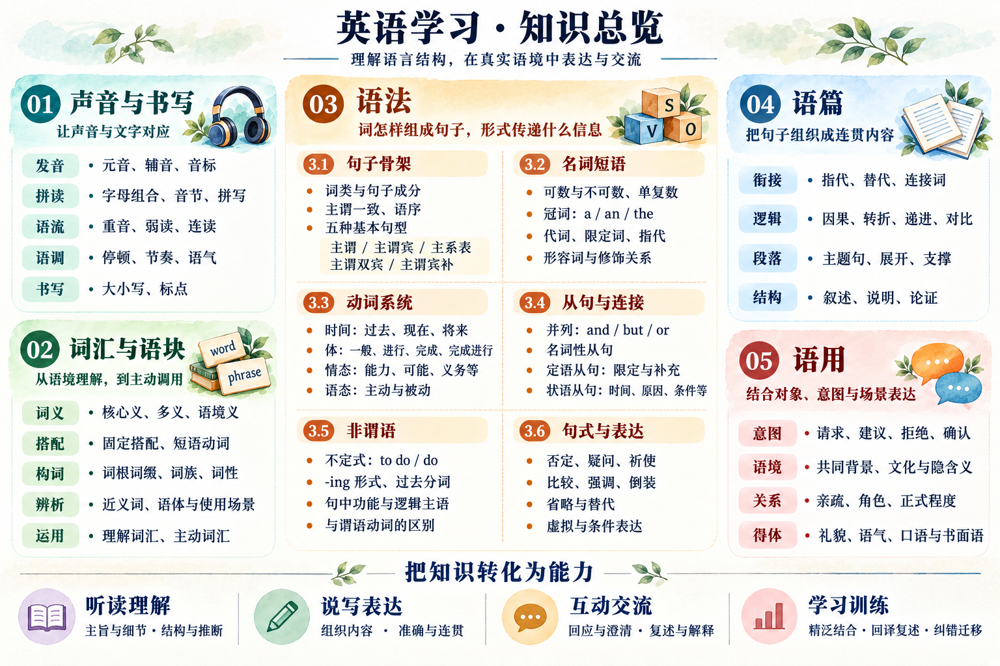

# 英语学习知识地图

[[wiki/英语学习/00-索引|返回英语学习索引]] · [[wiki/英语学习/英语学习-学习指南|怎样使用这份大纲]]

勾选标准：能独立解释或使用，并在一个新例子中复测。未勾选表示待自测。

**新手先读[[wiki/英语学习/00-索引#概念详解|六篇概念详解]]，再用本页检查。** 下面原有 64 项均配有“详解”入口，展开概念、例句、易错处和自测；标为“进阶”的内容可以后学。原书框架与补充知识的来源归属保持区分。

## 总览图

[打开原图](../../assets/英语学习/英语学习-知识总览.png)

图用于定位分支；查漏以正文清单为准。

## 01 学习观念

- [ ] 学习方式：原书区分背诵、习得、理解；优先理解可解释的规律，记住约定，再通过使用检验能否调用。[原书学习方式][approaches] → [[wiki/英语学习/01-学习起点与自测#1 学习方式：理解、记忆与使用分别解决什么|详解]]
- [ ] 中英表达：原书强调三处差异——分句的谓语与其他动词形式、词性对应的词形、英语的时态形式；避免按中文逐词套用。[原书对照][contrast] → [[wiki/英语学习/01-学习起点与自测#2 中英表达：先确定意思，再选择英语结构|详解]]
- [ ] 目标倒推：先确定要用英语完成什么，再选相应的词、句、篇和材料；词汇从“认得”推进到“会读写、能主动用”。[原书词句篇][units] → [[wiki/英语学习/01-学习起点与自测#3 目标倒推：把目标写成能观察的任务|详解]]
- [ ] 学习安排：原书主张一段时间集中突破一个难点，再分阶段推进；间隔复习与真实使用用于检验保持情况。[原书集中训练][focus] → [[wiki/英语学习/01-学习起点与自测#4 学习安排：补一个缺口，再回到任务|详解]]

## 02 单词与声音

- [ ] **声音与拼写**：先练容易辨认的音，再攻易混音；音标学到能查词、跟读即可，同时观察音与字母组合的对应，遇到例外核对词典录音。重音、弱读、连读、语调及书写规范按需要补。[原书拼读][pronunciation] → [[wiki/英语学习/02-声音与词汇#1 字母、音素与音标|音标]] · [[wiki/英语学习/02-声音与词汇#2 拼读、拼写与词尾读音|拼读]] · [[wiki/英语学习/02-声音与词汇#3 音节、重音与弱读|重音]] · [[wiki/英语学习/02-声音与词汇#4 连读、音的变化、节奏与语调|语流]] · [[wiki/英语学习/02-声音与词汇#5 书写规范与数字|书写]]
- [ ] **词义**：先看当前语境义，再比较相关义项与独立义项；“核心义串联”是线索，不保证每个义项都能由单一核心义推出。[原书词义][meaning] → [[wiki/英语学习/02-声音与词汇#6 词义：一个词不只对应一个中文|详解]]
- [ ] **词形与“词伙”**：分清屈折变化与构词；原书“词伙”指同一词族的派生词及其词性变化，如 `produce → producer → production`，不是固定搭配。认识词形后，还要核对实际词义与搭配，不能直接套用原书个别生硬例句。[原书词伙][family] → [[wiki/英语学习/02-声音与词汇#7 屈折、构词与词族|详解]]
- [ ] **搭配与语块（补充）**：固定搭配、短语动词、常用表达，连同搭配对象和句法位置一起学习。 → [[wiki/英语学习/02-声音与词汇#8 搭配、语块、短语动词与习语|详解]]
- [ ] **介词专项**：空间、时间、抽象关系与固定搭配；能说明介词连着什么、整块表达什么关系。 → [[wiki/英语学习/02-声音与词汇#9 介词：标明关系，连同后面的内容一起看|详解]]
- [ ] **运用程度**：认得意思 → 会读写 → 离开原文能主动用；另检查是否能在听力中认出。[原书词句篇][units] → [[wiki/英语学习/02-声音与词汇#10 一个词怎样算会，以及怎样复习|详解]]
- [ ] **记忆与复习（补充）**：能按难记、遗忘、混淆或不会用选择练习，并在隔时、换语境后复测。见[[wiki/英语学习/词汇学习-记忆方法与复习|十种方法与复习安排]]。 → [[wiki/英语学习/词汇学习-记忆方法与复习#十种方法怎样选|详解]]

例如 `fix a bug`：一起学习读音、意思、搭配和自己的例句。拼读有例外，核心义不能解释所有义项。

## 03 语法

原书以谓语为线索，依次学习主谓与主系表两类句型、词性、时态、语态、从句和其他语法。下列清单按知识关系扩展；分析时逐个分句找谓语，区分非谓语。[原书语法框架][grammarbook]

### 基础概念与句子骨架

- [ ] 词类、结构与句中功能：能区分词的类别、词组成的单位，以及这个单位在句中承担的任务。 → [[wiki/英语学习/03-词类与句子骨架#1 词类、结构与句中功能是三个角度|详解]]
- [ ] 结构层级：单词、短语、从句与句子；识别谓语动词组合与非谓语结构。 → [[wiki/英语学习/03-词类与句子骨架#2 单词、短语、分句与句子|详解]]
- [ ] 句子成分：主语、谓语、宾语、表语、补语，以及修饰关系和状语。 → [[wiki/英语学习/03-词类与句子骨架#3 主语、谓语、宾语、表语、补语和状语|详解]]
- [ ] 基本句型：原书将主谓、主谓宾、主谓双宾、主谓宾补归为主谓类，主系表单列；结合动词用法判断必需信息。[原书句型][patterns] → [[wiki/英语学习/03-词类与句子骨架#4 基本句型：由动词决定需要什么|详解]]
- [ ] 语序与一致：主谓一致、必需成分与附加信息；能解释主语为什么不一定是动作发出者。 → [[wiki/英语学习/03-词类与句子骨架#5 语序、主谓一致与信息完整|详解]]

### 名词与指称

- [ ] 可数性、单复数与所有关系。 → [[wiki/英语学习/03-词类与句子骨架#6 可数性、单复数与所有关系|详解]]
- [ ] 冠词、限定词与数量表达：`a/an/the`、零冠词、指示、所属和数量等。 → [[wiki/英语学习/03-词类与句子骨架#7 冠词、限定词与数量|详解]]
- [ ] 代词与指代：明确指向谁或什么，区分相应形式。 → [[wiki/英语学习/03-词类与句子骨架#8 代词与指代|详解]]
- [ ] 名词短语扩展：中心词、前置修饰、后置说明与补足内容。[名词短语依据][noun] → [[wiki/英语学习/03-词类与句子骨架#9 名词短语：找中心词，再看扩展|详解]]

### 修饰与关系

- [ ] 形容词：描述对象的性质，区分定语和表语等位置。 → [[wiki/英语学习/03-词类与句子骨架#10 形容词与副词|详解]]
- [ ] 副词：修饰动作、程度或整个陈述等；判断具体修饰对象。 → [[wiki/英语学习/03-词类与句子骨架#10 形容词与副词|详解]]
- [ ] 介词短语：看内部组合与外部归属，区分修饰和补足作用。 → [[wiki/英语学习/03-词类与句子骨架#11 介词短语的归属与补足|详解]]

### 动词系统

- [ ] 主要动词、系动词、助动词：认识 `be/have/do` 在不同结构中的作用。 → [[wiki/英语学习/04-动词与时间表达#1 主要动词、系动词与助动词|详解]]
- [ ] 动词形式：原形、第三人称单数、过去式、过去分词、-ing 形式与不规则变化。 → [[wiki/英语学习/04-动词与时间表达#2 动词的五种常见形式|详解]]
- [ ] 时态、体与时间表达：过去、现在、将来怎样表达；区分一般、进行、完成与完成进行等常见组合。 → [[wiki/英语学习/04-动词与时间表达#3 时间、时态与体|详解]] · [[wiki/英语学习/04-动词与时间表达#5 其余组合与将来表达|补充]]
- [ ] 原书“八时态”是入门的八个锚点：一般现在、现在进行、一般过去、一般将来、现在完成、过去进行、过去完成、过去将来；英语动词组合不止这八种。[原书八时态][tenses] → [[wiki/英语学习/04-动词与时间表达#4 原书的八个入门锚点|详解]]
- [ ] 情态：能力、可能、许可、义务、建议等，结合语境理解。 → [[wiki/英语学习/04-动词与时间表达#6 情态：说话人对事情的判断或要求|详解]]
- [ ] 语态：主动、被动与信息焦点；区分施事、受事和语法主语。 → [[wiki/英语学习/04-动词与时间表达#7 主动与被动|详解]]
- [ ] 动词组合：把 `has been fixed` 等作为整体识别，再分析完成、被动等信息。[动词组合依据][verb] → [[wiki/英语学习/04-动词与时间表达#8 动词组合怎样拆|详解]]

### 连接与嵌套

- [ ] 并列：连接词、短语或从句，判断共享与省略的成分。 → [[wiki/英语学习/05-从句与句式#1 并列：把同一层的内容连起来|详解]]
- [ ] 名词性从句：把一件事作为主语、宾语等位置的内容。 → [[wiki/英语学习/05-从句与句式#2 名词性从句：把一件事放进一个位置|详解]]
- [ ] 定语从句：识别对象或补充信息，判断关系词的作用和省略条件。 → [[wiki/英语学习/05-从句与句式#3 定语从句：识别对象或补充说明|详解]]
- [ ] 状语从句：时间、原因、条件、让步、目的、结果等关系。 → [[wiki/英语学习/05-从句与句式#4 状语从句与从句分析顺序|详解]]
- [ ] 分析从句时先看连接词表达的关系，再检查从句内部语序与它在主句中的位置。[原书从句][clauses] → [[wiki/英语学习/05-从句与句式#4 状语从句与从句分析顺序|详解]]

### 非谓语

- [ ] 形式：带或不带 `to` 的不定式、-ing 形式、过去分词。 → [[wiki/英语学习/05-从句与句式#5 非谓语的形式与功能|详解]]
- [ ] 分析：内部结构、在外层句中的功能、逻辑主语与时间关系。 → [[wiki/英语学习/05-从句与句式#内部结构、逻辑主语与时间|详解]]
- [ ] 辨析：与限定从句、进行结构、被动结构相比较。 → [[wiki/英语学习/05-从句与句式#与完整谓语结构对比|详解]]

`to do` 不必然表示将来，-ing 不必然表示正在，过去分词不必然表示过去时间；要靠整个结构与语境判断。[限定与非限定动词依据][finite]

### 句式与表达模式

- [ ] 陈述、疑问、否定、祈使与感叹；理解助动词在疑问和否定中的作用。 → [[wiki/英语学习/05-从句与句式#6 陈述、疑问、否定、祈使与感叹|详解]]
- [ ] 比较、强调、倒装、省略与替代。 → [[wiki/英语学习/05-从句与句式#7 比较与程度|详解]] · [[wiki/英语学习/05-从句与句式#9 强调、倒装、省略与替代|补充]]
- [ ] 条件与虚拟表达：区分现实条件、设想和与事实有距离的情形。 → [[wiki/英语学习/05-从句与句式#8 条件与虚拟表达|详解]]
- [ ] 常用结构：`there be`、形式主语、形式宾语及其他约定表达。 → [[wiki/英语学习/05-从句与句式#10 there、it 与常用动词结构|详解]] · [[wiki/英语学习/05-从句与句式#11 直接与间接引语|补充]]

## 04 篇章与阅读

- [ ] **长句分析**：先找主句骨架，再辨认原书强调的三种常见扩展——非谓语短语、介词短语、从句；接回整体时保留否定、条件、指代与前置修饰。[原书长句][longsentence] → [[wiki/英语学习/06-阅读听力与表达#1 长句：先找关系，再接回全部信息|详解]]
- [ ] **篇章组织**：主旨、段落中心、支撑信息；因果、转折、递进、对比与例证；指代、衔接、作者立场和隐含信息。 → [[wiki/英语学习/06-阅读听力与表达#2 篇章：主旨、段落作用与逻辑关系|详解]]
- [ ] **精读**：通读大意、分析篇章、细读句词、回译、口头复述；复述时检查主旨、逻辑和各段要点。见[[wiki/英语学习/英语学习-学习指南#读写练习|练习步骤]]。[原书精读][reading] → [[wiki/英语学习/06-阅读听力与表达#3 精读、泛读与选材|详解]]
- [ ] **泛读**：关注内容，练连续理解；固定时间和内容来源，也可利用碎片时间。 → [[wiki/英语学习/06-阅读听力与表达#3 精读、泛读与选材|详解]]
- [ ] **选材**：先按目标选课文、真题、报刊或真实业务材料，再试读；原书建议选初看约能读懂八成、但仍有难点的文章。“八成”只是难度参考，不是硬门槛。[原书选文][selection] → [[wiki/英语学习/06-阅读听力与表达#3 精读、泛读与选材|详解]]

划括号是为了整块理解，不能因此忽略其中的信息。

## 05 听力

- [ ] **声音识别**：词边界、实际读音、弱读和连读等连续语流现象。[连续语流依据][speech] → [[wiki/英语学习/06-阅读听力与表达#4 听力里的声音识别与内容理解|详解]]
- [ ] **内容理解**：主旨、细节、逻辑与说话意图。 → [[wiki/英语学习/06-阅读听力与表达#4 听力里的声音识别与内容理解|详解]]
- [ ] **精听**：原书的训练四轮为听全文大意 → 逐句听写 → 全文再听并对照原文 → 细听错误句；另区分写错、声音没认出和文字也不懂。[原书四轮精听][listening] → [[wiki/英语学习/06-阅读听力与表达#5 精听、泛听与听力诊断|详解]]
- [ ] **泛听**：用较容易的材料练连续理解，不依赖逐句暂停。 → [[wiki/英语学习/06-阅读听力与表达#5 精听、泛听与听力诊断|详解]]
- [ ] **诊断**：分别检查文字也不懂、文字懂但声音没认出、能分段理解但连续跟不上等情况。 → [[wiki/英语学习/06-阅读听力与表达#5 精听、泛听与听力诊断|详解]]

## 06 考试与原书学习问答

- [ ] 摸索目标考试的出题方式和题型。 → [[wiki/英语学习/01-学习起点与自测#5 考试：语言能力与执行题目分开练|详解]]
- [ ] 按题型专项练习，找适合自己的做题顺序。 → [[wiki/英语学习/01-学习起点与自测#5 考试：语言能力与执行题目分开练|详解]]
- [ ] 错题归因与复测：区分语言理解和任务执行问题。 → [[wiki/英语学习/01-学习起点与自测#5 考试：语言能力与执行题目分开练|详解]]

原书“10问”讨论适用起点、考试、口语、背诵等方法边界；口语仍需专门开口练习。[原书10问][questions] 没有考试目标时，可暂缓考试训练。

## 07 表达与交际

- [ ] **说写**：组织内容、选择表达、保持准确与连贯。 → [[wiki/英语学习/06-阅读听力与表达#6 说与写：组织内容、选择表达、检查意思|详解]]
- [ ] **互动**：提问、回应、确认、澄清与修正误解。 → [[wiki/英语学习/06-阅读听力与表达#7 互动：让交流继续并修复误解|详解]]
- [ ] **语用**：交际意图、对象关系、礼貌、语气、正式程度与文化背景。 → [[wiki/英语学习/06-阅读听力与表达#8 语用：句子之外还要看对象和场景|详解]]
- [ ] **迁移**：在软件工作、技术讨论、旅行或日常场景中完成一个具体任务。 → [[wiki/英语学习/06-阅读听力与表达#9 场景迁移与综合检验|详解]]

例如在工作中说明“问题是什么、已做什么、还有什么条件”；在旅行中说明需求、听懂答复并澄清不确定处。

## 08 检验与反馈

- [ ] **理解检验**：用自己的话保留关键信息，说明真实意思。 → [[wiki/英语学习/01-学习起点与自测#6 五类检验：怎样知道自己学会了|详解]]
- [ ] **表达检验**：撤掉原句后，独立组织表达。 → [[wiki/英语学习/01-学习起点与自测#6 五类检验：怎样知道自己学会了|详解]]
- [ ] **迁移检验**：换人物、时间、内容或场景，仍能使用相同知识。 → [[wiki/英语学习/01-学习起点与自测#6 五类检验：怎样知道自己学会了|详解]]
- [ ] **听力检验**：换新录音，记录首次接触理解了什么。 → [[wiki/英语学习/01-学习起点与自测#6 五类检验：怎样知道自己学会了|详解]]
- [ ] **错误归因**：区分词义、结构、声音、语境或提取不熟，再选择对应练习。 → [[wiki/英语学习/01-学习起点与自测#错误归因|详解]]

## 来源与范围

01—06 依廖恒《学好英语，4个月就够了》的[目录][book]与所链接的关键正文重组，未标“原书”的语言细项也包含系统补充；07—08 是补充。已核对目录与核心方法段落，未逐字校对全书及全部例句。书名中的“四个月”和书内具体速成数字不作为效果保证。[[raw/links/2026-10-22-英语学习地图-来源与核验范围|建图时来源记录]]保留初版的核验范围。

“02 单词与声音”中的记忆与复习入口补充康文捷《30天搞定零基础英语必备1000词》第2—4讲与相关研究，具体说明见[[raw/links/2026-10-22-单词记忆十大方法-来源与核验范围|单词记忆方法来源记录]]。

[[wiki/英语学习/00-索引|返回英语学习索引]]

[book]: https://www.dedao.cn/ebook/detail?id=ekM2z5Kexap9AKyJEz8DOYn6GNrV20KNyGmwdgbRXq1Qvlj7P5ZmoMkLB47y6ONA
[approaches]: https://weread.qq.com/web/reader/08532ae0813aba2afg015e45ka87322c014a87ff679a21ea
[contrast]: https://weread.qq.com/web/reader/08532ae0813aba2afg015e45ke4d32d5015e4da3b7fbb1fa
[units]: https://weread.qq.com/web/reader/08532ae0813aba2afg015e45k16732dc0161679091c5aeb1
[focus]: https://weread.qq.com/web/reader/08532ae0813aba2afg015e45kc9f326d018c9f0f895fb5e4
[pronunciation]: https://weread.qq.com/web/reader/08532ae0813aba2afg015e45kc20321001cc20ad4d76f5ae
[meaning]: https://weread.qq.com/web/reader/08532ae0813aba2afg015e45kc51323901dc51ce410c121b
[family]: https://weread.qq.com/web/reader/08532ae0813aba2afg015e45kc51323901dc51ce410c121b
[grammarbook]: https://weread.qq.com/web/reader/08532ae0813aba2afg015e45k9bf32f301f9bf31c7ff0a60
[patterns]: https://weread.qq.com/web/reader/08532ae0813aba2afg015e45k70e32fb021170efdf2eca12
[tenses]: https://weread.qq.com/web/reader/08532ae0813aba2afg015e45k1f032c402131f0e3dad99f3
[clauses]: https://weread.qq.com/web/reader/08532ae0813aba2afg015e45k3c5327902153c59dc0488e1
[longsentence]: https://weread.qq.com/web/reader/08532ae0813aba2afg015e45k33e3289021c33e75ff09694
[reading]: https://weread.qq.com/web/reader/08532ae0813aba2afg015e45k02e32f0021b02e74f10ece8
[selection]: https://weread.qq.com/web/reader/08532ae0813aba2afg015e45k4e73277021a4e732ced3b55
[listening]: https://weread.qq.com/web/reader/08532ae0813aba2afg015e45kc1632f5021fc16a5320f3dc
[questions]: https://weread.qq.com/web/reader/08532ae0813aba2afg015e45k636320102206364d3f0ffdc
[noun]: https://dictionary.cambridge.org/us/grammar/british-grammar/noun-phrases-dependent-words
[verb]: https://learnenglish.britishcouncil.org/free-resources/grammar/english-grammar-reference/verb-phrases
[finite]: https://dictionary.cambridge.org/grammar/british-grammar/finite-and-non-finite-
[speech]: https://www.teachingenglish.org.uk/professional-development/teachers/knowing-subject/connected-speech-part-1
